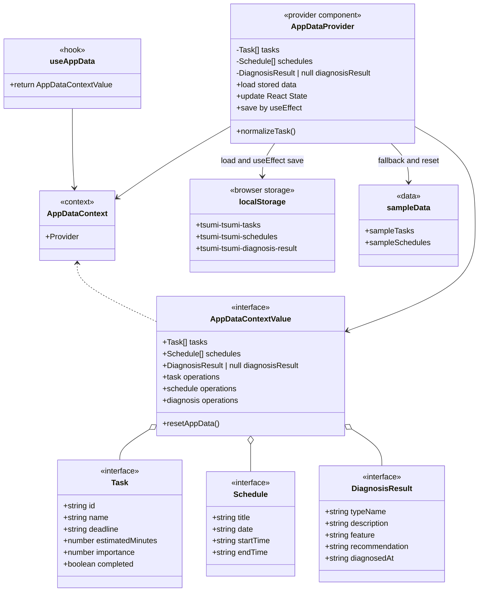
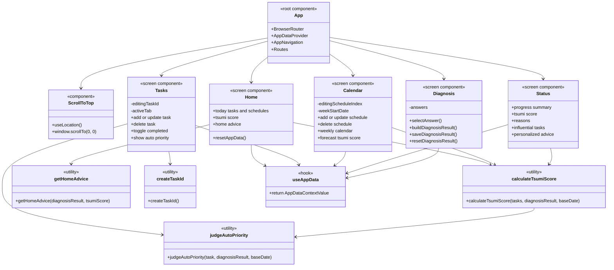

# クラス図

この資料は、現在の実装を「データ管理」と「画面・ユーティリティ」に分けて整理したクラス図です。Reactの画面は関数コンポーネントであり、通常のクラスではありません。授業提出用に構成要素として読みやすくするため、`<<screen component>>` や `<<hook>>` などのステレオタイプを付けています。

## データ管理クラス図

## 画面・ユーティリティ関係図

## 図の読み方

- `Task`、`Schedule`、`DiagnosisResult` はTypeScriptの型です。画面で扱うデータの形を決めています。
- `AppDataProvider` はアプリ全体のデータ管理を担当します。Context操作関数ではReact Stateを更新し、localStorage保存はState変更後の `useEffect` で行います。
- `AppDataContextValue` は、Contextを通して画面へ渡すデータと操作関数の一覧です。
- `useAppData` は、各画面が `AppDataContext` を簡単に利用するためのカスタムフックです。
- `Home`、`Tasks`、`Calendar`、`Status`、`Diagnosis` はReactの関数コンポーネントです。通常のクラスではなく、画面単位の処理をまとめたものとして表しています。
- `calculateTsumiScore`、`judgeAutoPriority`、`getHomeAdvice`、`createTaskId` は共通処理です。画面やContextから呼び出されます。
- `localStorage` には、タスク、予定、診断結果がJSON文字列として保存されます。

## 各要素の役割

| 要素 | 役割 |
|---|---|
| `Task` | タスク名、締切、見積時間、重要度、完了状態、一意なidを表します。 |
| `Schedule` | 予定名、日付、開始時刻、終了時刻を表します。 |
| `DiagnosisResult` | 診断タイプ、説明、特徴、おすすめの進め方、診断日時を表します。 |
| `AppDataProvider` | localStorageからデータを読み込み、Contextで各画面へ共有します。追加、編集、削除、リセット時はStateを更新します。 |
| `Home` | 今日のタスク、今日の予定、現在のつみ度、診断結果に応じたアドバイス、データリセットを表示します。 |
| `Tasks` | タスクの追加、編集、削除、完了切り替え、未完了/完了タブ、自動優先度表示を行います。 |
| `Calendar` | 予定の追加、編集、削除、週間カレンダー、推定つみ度を表示します。 |
| `Status` | 完了数、未完了数、達成率、残り見積、つみ度、危険理由、影響タスク、診断タイプ別アドバイスを表示します。 |
| `Diagnosis` | 7問の質問に対する回答から診断タイプを決定し、診断結果を保存します。 |
| `calculateTsumiScore` | 未完了タスク、締切、重要度、見積時間、自動優先度をもとにつみ度を計算します。 |
| `judgeAutoPriority` | タスクの重要度、締切、見積時間、診断結果から自動優先度を判定します。 |
| `getHomeAdvice` | 診断結果とつみ度からHome画面向けの短い行動コメントを生成します。 |
| `createTaskId` | 新規タスク追加時と旧形式タスク移行時に一意なタスクidを生成します。 |
