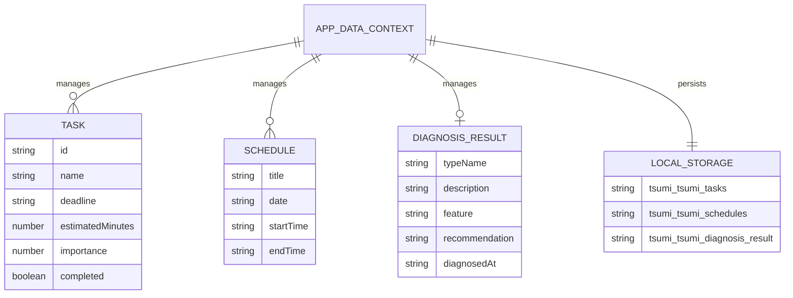

# データ構造

この資料は、現在のTypeScript型、Context、localStorage保存形式を実装に基づいてまとめたものです。

## Task

定義ファイル: `src/types/task.ts`

| プロパティ名 | TypeScriptの型 | 必須 | 値の例 | 意味 | 主な利用箇所 |
|---|---|---|---|---|---|
| `id` | `string` | 必須 | `sample-task-report-20260801` | タスクを一意に識別するidです。追加、編集、削除、完了切り替えで使います。 | Tasksの操作、Calendarの締切表示、Statusの影響タスク表示 |
| `name` | `string` | 必須 | `情報システム論レポート提出` | タスク名です。 | Home, Tasks, Calendar, Status |
| `deadline` | `string` | 必須 | `2026-08-01` | 締切日です。HTMLのdate入力と同じ `YYYY-MM-DD` 形式で扱います。 | Home, Tasks, Calendar, Status。つみ度計算と自動優先度判定でも間接利用 |
| `estimatedMinutes` | `number` | 必須 | `150` | 作業にかかる見積時間です。 | Tasks, Status。つみ度計算と自動優先度判定を通じてHome, Calendarでも間接利用 |
| `importance` | `number` | 必須 | `5` | ユーザーが入力する重要度です。1から5の値として入力されます。 | Tasks, Status。つみ度計算と自動優先度判定を通じてHome, Calendarでも間接利用 |
| `completed` | `boolean` | 必須 | `false` | 完了状態です。trueなら完了、falseなら未完了です。 | Home, Tasks, Calendar, Status。つみ度計算では未完了タスク抽出に利用 |

## Schedule

定義ファイル: `src/types/schedule.ts`

| プロパティ名 | TypeScriptの型 | 必須 | 値の例 | 意味 | 主な利用箇所 |
|---|---|---|---|---|---|
| `title` | `string` | 必須 | `ゼミミーティング` | 予定名です。 | Home, Calendar |
| `date` | `string` | 必須 | `2026-08-01` | 予定の日付です。HTMLのdate入力と同じ `YYYY-MM-DD` 形式で扱います。 | Homeの今日の予定、Calendarの週間表示 |
| `startTime` | `string` | 必須 | `10:30` | 予定の開始時刻です。HTMLのtime入力と同じ形式で扱います。 | Home, Calendar |
| `endTime` | `string` | 必須 | `11:30` | 予定の終了時刻です。開始時刻より後であることを入力チェックします。 | Home, Calendar、予定入力チェック |

## DiagnosisResult

定義ファイル: `src/types/diagnosis.ts`

| プロパティ名 | TypeScriptの型 | 必須 | 値の例 | 意味 | 主な利用箇所 |
|---|---|---|---|---|---|
| `typeName` | `string` | 必須 | `計画型` | 診断タイプ名です。実装上は `計画型`、`締切集中型`、`気分変動型`、`コツコツ型` のいずれかとして生成されます。 | Diagnosis, Home, Status。自動優先度判定とつみ度計算を通じてTasks, Calendarでも間接利用 |
| `description` | `string` | 必須 | `全体像をつかみ...` | 診断タイプの説明です。 | Diagnosis |
| `feature` | `string` | 必須 | `優先順位やスケジュールが...` | 学習やタスク管理の特徴です。 | Diagnosis |
| `recommendation` | `string` | 必須 | `まず今日やるタスクを3つに絞り...` | おすすめの進め方です。 | Diagnosis |
| `diagnosedAt` | `string` | 必須 | `2026-07-08T12:00:00.000Z` | 診断日時です。`new Date().toISOString()` で保存されます。 | Diagnosis |

Context上では `DiagnosisResult | null` として扱われます。`null` は未診断を表します。

## AppDataContextValue

定義ファイル: `src/context/DataContext.ts`

### 提供データ

| 名前 | 型 | 役割 |
|---|---|---|
| `tasks` | `Task[]` | 全タスク一覧です。 |
| `schedules` | `Schedule[]` | 全予定一覧です。 |
| `diagnosisResult` | `DiagnosisResult | null` | 保存済み診断結果です。未診断の場合は `null` です。 |

### タスク操作関数

| 関数名 | 引数 | 戻り値 | 役割 |
|---|---|---|---|
| `addTask` | `task: Task` | `void` | 新しいタスクを末尾に追加します。 |
| `updateTask` | `id: string`, `task: Task` | `void` | idが一致するタスクを新しい内容に差し替えます。 |
| `deleteTask` | `id: string` | `void` | idが一致するタスクを削除します。 |
| `toggleTaskCompleted` | `id: string` | `void` | idが一致するタスクの `completed` を反転します。 |

### 予定操作関数

| 関数名 | 引数 | 戻り値 | 役割 |
|---|---|---|---|
| `addSchedule` | `schedule: Schedule` | `void` | 新しい予定を末尾に追加します。 |
| `updateSchedule` | `index: number`, `schedule: Schedule` | `void` | indexが一致する予定を新しい内容に差し替えます。 |
| `deleteSchedule` | `index: number` | `void` | indexが一致する予定を削除します。 |

### 診断操作関数

| 関数名 | 引数 | 戻り値 | 役割 |
|---|---|---|---|
| `saveDiagnosisResult` | `result: DiagnosisResult` | `void` | 診断結果を保存します。 |
| `resetDiagnosisResult` | なし | `void` | 診断結果を `null` に戻します。 |

### データリセット関数

| 関数名 | 引数 | 戻り値 | 役割 |
|---|---|---|---|
| `resetAppData` | なし | `void` | localStorageの保存データを削除し、タスクと予定をサンプルデータへ戻し、診断結果を未診断へ戻します。 |

## localStorage

実装ファイル: `src/context/AppDataContext.tsx`

| localStorageキー | 保存されるデータ | データ形式 | 読み込みタイミング | 保存タイミング | リセット時 |
|---|---|---|---|---|---|
| `tsumi-tsumi-tasks` | `Task[]` | JSON文字列 | `AppDataProvider` の初期化時 | `tasks` が変わった後の `useEffect` | `removeItem` 後、Stateを `sampleTasks` へ戻す。State変更後の `useEffect` でサンプルタスクが再保存されます。 |
| `tsumi-tsumi-schedules` | `Schedule[]` | JSON文字列 | `AppDataProvider` の初期化時 | `schedules` が変わった後の `useEffect` | `removeItem` 後、Stateを `sampleSchedules` へ戻す。State変更後の `useEffect` でサンプル予定が再保存されます。 |
| `tsumi-tsumi-diagnosis-result` | `DiagnosisResult` | JSON文字列 | `AppDataProvider` の初期化時 | `diagnosisResult` が `null` 以外になった後の `useEffect`。`null` の場合は削除 | `removeItem` 後、Stateを `null` へ戻す。`useEffect` でも診断結果キーが削除されます。 |

### 読み込み時の復旧

- タスクと予定は、保存データがない場合にサンプルデータを使います。
- タスクと予定のJSONが壊れている場合もサンプルデータへ戻します。
- 診断結果は、保存データがない場合またはJSONが壊れている場合に `null` になります。
- タスクは `normalizeTask` を通して現在の `Task` 型へそろえます。

### 旧データ移行

現在の実装で確認できる移行処理は次の通りです。

| 旧形式 | 現在の形式 | 移行処理 |
|---|---|---|
| `id` がないタスク | `id: string` を持つ `Task` | `createTaskId()` でidを補完します。 |
| `priority` を持つタスク | `importance` を持つ `Task` | `importance ?? priority ?? 3` の順で重要度を決めます。 |
| 空文字の `id` | 有効な `id` | `createTaskId()` でidを補完します。 |

## データ間の関係

- `Task` はHome、Tasks、Calendar、Statusで使用されます。
- `Schedule` はHome、Calendarで使用されます。
- `DiagnosisResult` はHome、Status、Tasksの自動優先度判定、Calendarの推定つみ度で使用されます。
- 各画面は `useAppData` を通して同じContextデータを参照します。
- ContextのStateが変わると、関連する画面表示とlocalStorage保存が更新されます。
