# シーケンス図

この資料では、現在の実装にある主な処理の流れをMermaidのシーケンス図で整理します。実装に存在しない処理は追加せず、コードで確認できた動きに合わせています。タスク、予定、診断結果の永続化は、Context操作関数の中で直接保存するのではなく、React State変更後に `useEffect` がlocalStorageへ保存します。

## 1. アプリ起動時のデータ読み込み

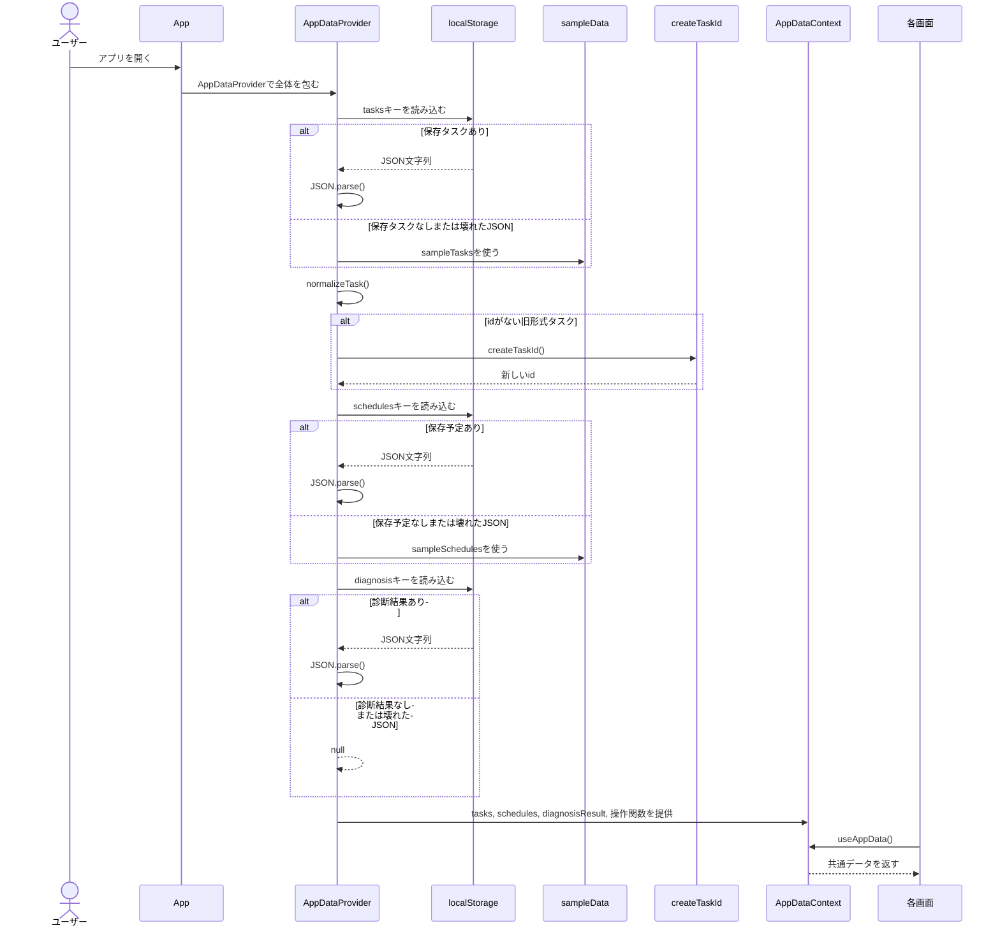

初回表示では `AppDataProvider` の `useState` 初期化関数が実行されます。保存データがない場合は `sampleTasks` と `sampleSchedules` を使い、診断結果は `null` になります。タスクは `normalizeTask` を通るため、古い保存形式で `id` がない場合も `createTaskId` で補完されます。

## 2. タスク追加

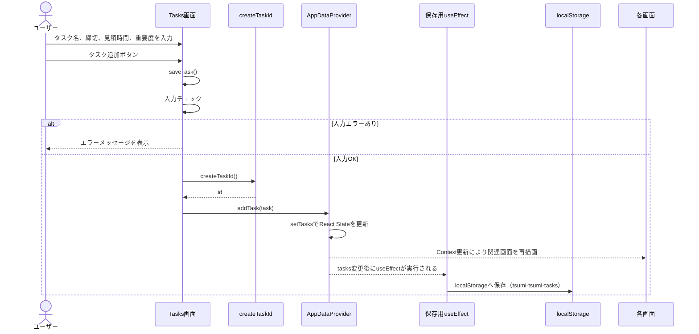

タスク追加では、空欄や見積時間が1分未満の入力を保存しません。保存時に `Task` オブジェクトを作り、`createTaskId` でidを設定してから `addTask` を呼び出します。localStorage保存は `tasks` 変更後の `useEffect` が行います。

## 3. タスク編集

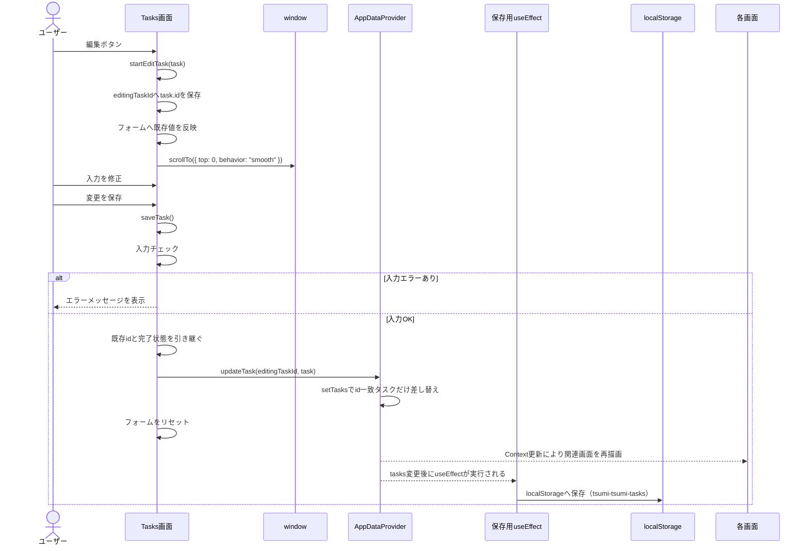

編集対象は `editingTaskId` に保存されます。更新時は配列のindexではなくidで対象を特定するため、表示順が変わっても別タスクを更新しにくい設計です。

## 4. タスク削除

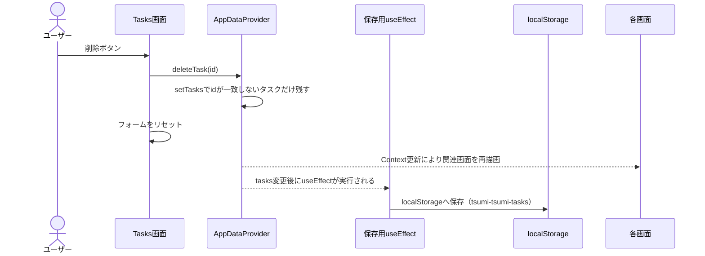

現在の実装では、タスク削除前の確認ダイアログはありません。削除ボタンから直接 `deleteTask(id)` が呼ばれ、対象id以外のタスクを残す形でStateが更新されます。

## 5. タスク完了・未完了切り替え

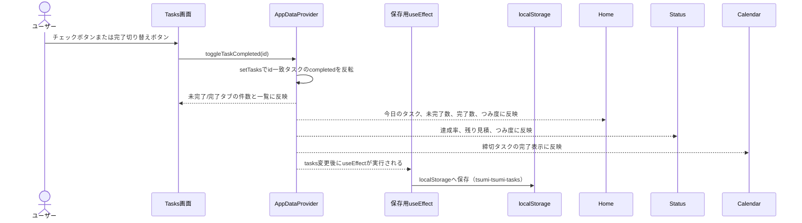

完了状態だけを反転し、タスク名や締切などの他の項目はそのまま引き継ぎます。つみ度計算は未完了タスクを対象にするため、HomeとStatusの点数にも影響します。

## 6. 予定追加

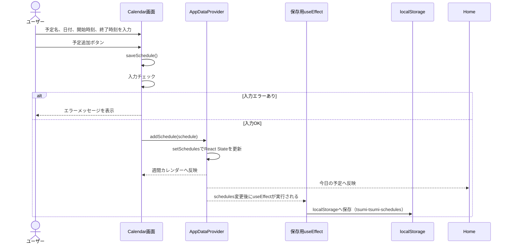

予定追加では、予定名、日付、開始時刻、終了時刻が必須です。終了時刻が開始時刻以下の場合も保存しません。

## 7. 予定編集

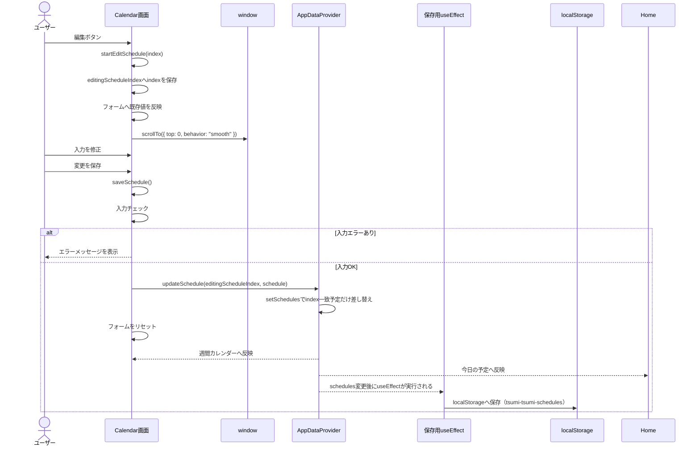

予定は現在、タスクのようなidを持っていません。そのため、編集対象は `editingScheduleIndex` で管理されています。

## 8. 予定削除

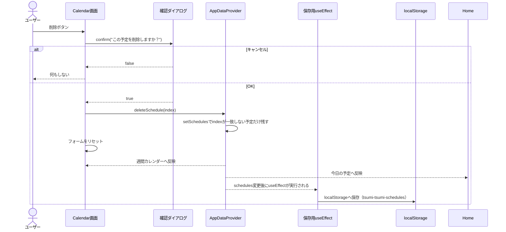

予定削除には確認ダイアログがあります。キャンセル時は何も更新せず、OK時だけ `deleteSchedule(index)` を実行します。

## 9. 診断実行と結果保存

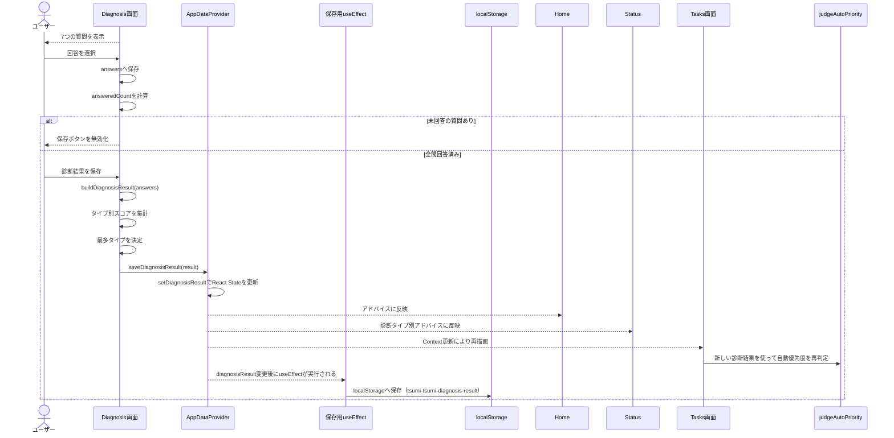

診断は7問すべてに回答すると保存できます。診断結果にはタイプ名、説明、特徴、おすすめの進め方、診断日時が保存されます。

## 10. つみ度計算と表示

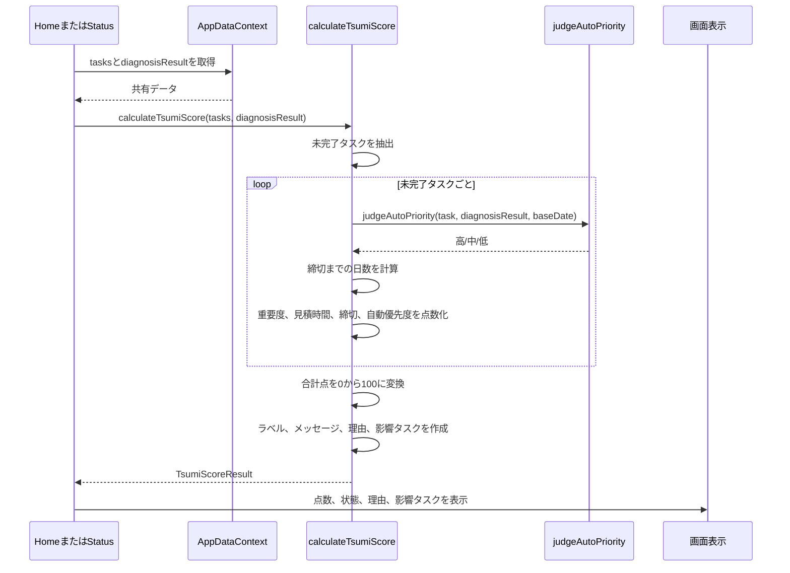

つみ度は未完了タスクだけを対象にします。締切、重要度、見積時間、自動優先度を使い、点数、ラベル、メッセージ、理由、影響タスク、内訳を返します。

## 11. Calendarの推定つみ度

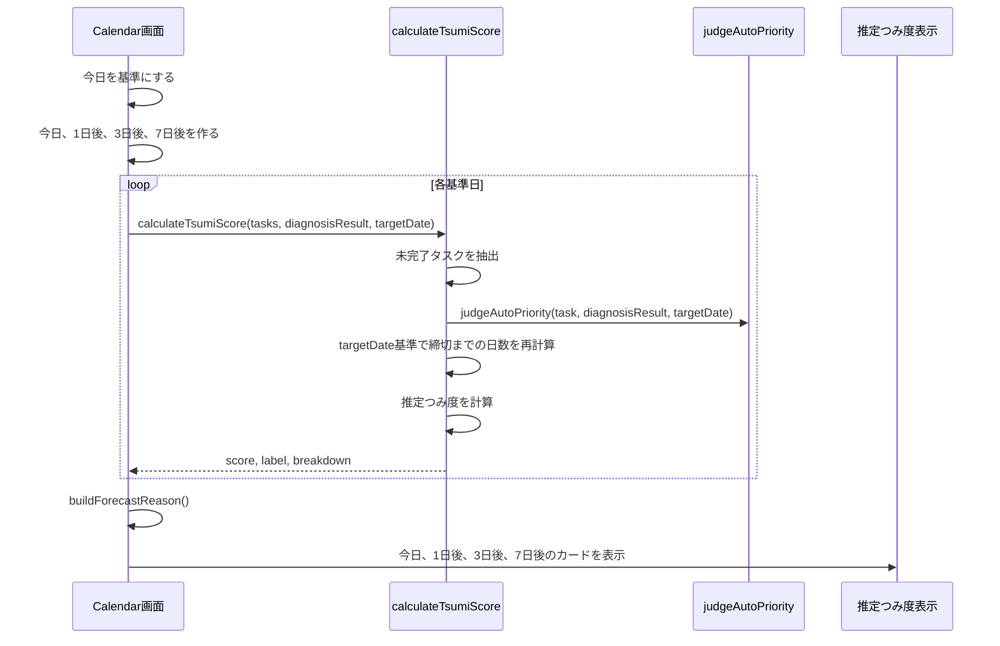

Calendarでは `calculateTsumiScore` に未来の日付を渡します。そのため、同じ未完了タスクでも基準日が進むほど締切超過や締切接近が反映されます。

## 12. データリセット

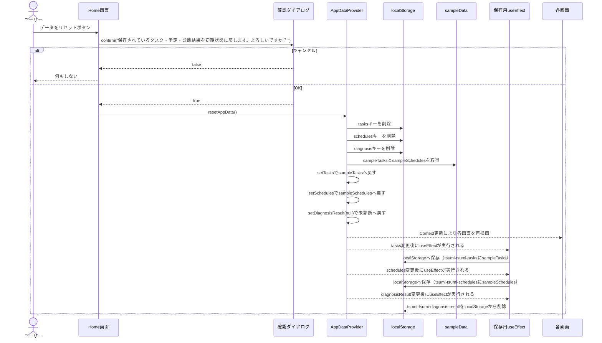

データリセットはHome画面から実行します。`resetAppData` は先にlocalStorageの3キーを削除し、その後Stateを初期状態へ戻します。State変更後、`useEffect` によりサンプルタスクとサンプル予定は再保存され、診断結果キーは `diagnosisResult === null` のため削除状態になります。

## 13. 画面遷移

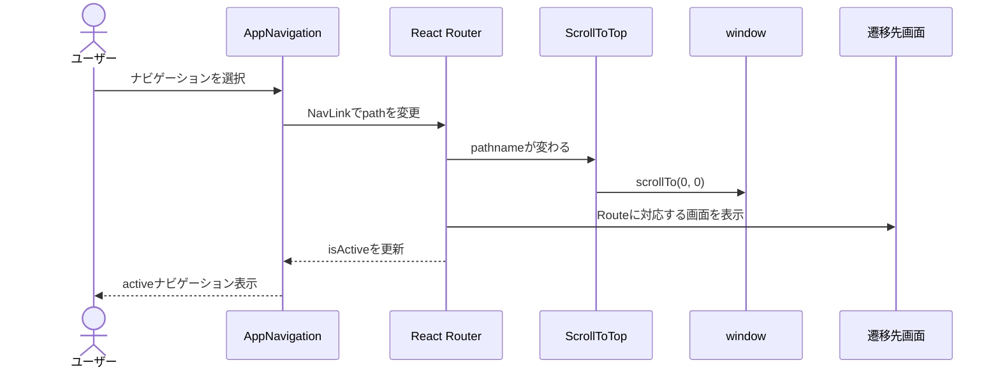

画面遷移はReact Routerで行います。`ScrollToTop` が `pathname` の変化を監視し、遷移時にページ上部へ戻します。ナビゲーションの選択状態は `NavLink` の `isActive` で更新されます。
